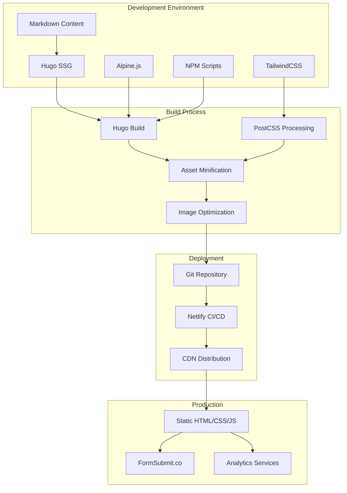
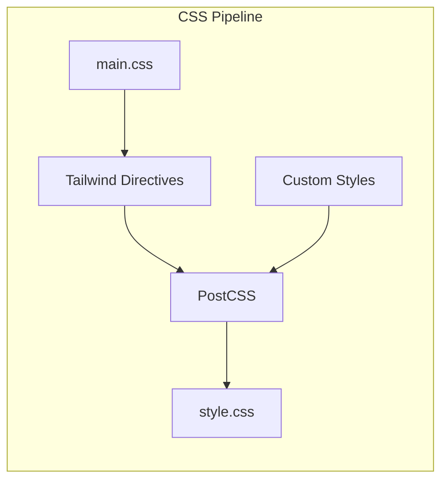
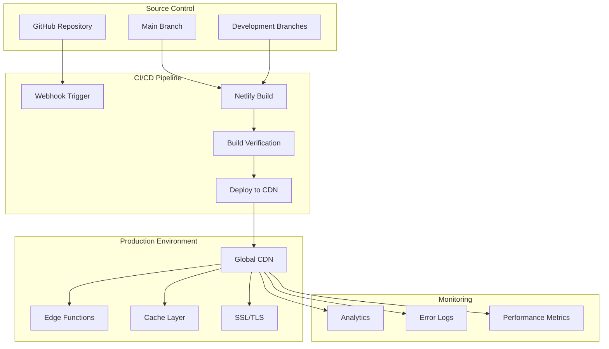
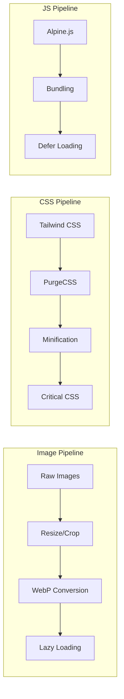

# Executive Speech Coaching NYC Technical Design

## Architecture Overview

The Executive Speech Coaching NYC website is built as a static site using the JAMstack architecture REDACTED_AIRTABLE_PAT, leveraging Hugo for static site generation, TailwindCSS for styling, and Alpine.js for interactive components.



<!-- Dev Note [2025-08-05T14:45]:
- Section: Architecture overview
- Based on: package.json, netlify.toml, build scripts, config.yaml
- Assumptions: Standard JAMstack deployment REDACTED_AIRTABLE_PAT
- Validation needed: Exact Netlify configuration, CDN details
-->

## Component Design

### Core Components

#### 1. Layout System
**Base Layout** (`layouts/_default/baseof.html`)
- Provides the HTML structure for all pages
- Includes head, navigation, main content area, and footer
- Manages dark mode state and theme persistence

**Partial Components**
- `nav.html`: Responsive navigation with dropdown support
- `footer.html`: Site footer with social links and navigation
- `head.html`: Meta tags, CSS, and script includes
- `meta.html`: SEO and Open Graph tags
- `pagination.html`: Blog post pagination controls

#### 2. Content Templates

**Homepage** (`layouts/index.html`)
- Hero section with video embed
- Partner logos carousel
- Mission statement
- Solution benefits grid
- Testimonial section
- About section with photo

**Service Pages** (`layouts/services/`)
- Service hero with image
- Service description
- Skills grid
- Dual CTA buttons (virtual/in-person)
- Related services navigation

**Blog/Posts** (`layouts/_default/single.html`)
- Post header with metadata
- Content area with typography styles
- Author information
- Social sharing buttons
- Related posts section

<!-- Dev Note [2025-08-05T14:50]:
- Section: Component design for layout system and templates
- Based on: layouts/ directory structure and template files
- Assumptions: Standard Hugo template hierarchy
- Validation needed: Custom shortcode implementations
-->

### Interactive Components

#### Dark Mode System
```javascript
// darkmode.js architecture
DarkModeController {
  - state: localStorage
  - toggle(): void
  - init(): void
  - updateDOM(): void
}
```

#### Alpine.js Components
- Mobile menu toggle
- Dropdown navigation
- Form validation
- Interactive UI elements

### Styling Architecture



<!-- Dev Note [2025-08-05T14:55]:
- Section: Interactive components and styling
- Based on: assets/js/darkmode.js, tailwind.config.js, main.css
- Assumptions: Standard Tailwind + Alpine integration
- Validation needed: Specific Alpine component implementations
-->

## Data Models

### Content Schema

#### Page Front Matter
```yaml
Page:
  title: string
  description: string
  draft: boolean
  date: datetime
  lastmod: datetime
  weight: integer
  
HomePage extends Page:
  intro:
    title:
      highlighted_text: string
      main_text: string
    text:
      highlighted_text: string
      main_text: string
    button:
      text: string
      url: string
    video:
      url: string
      title: string
  partners:
    title: string
    list: Partner[]
  mission:
    title: string
    info: TextBlock[]
  solution:
    title: string
    text: string
    list: SolutionItem[]
  feedback:
    title: string
    text: string
    button: Button
    quote: Testimonial
  about:
    info: TextBlock[]
    photo: Image
```

#### Service Schema
```yaml
Service extends Page:
  service_image: string
  buttons: Button[]
  skills: string[]
  related_services: Service[]
```

#### Post Schema
```yaml
Post extends Page:
  author: string
  categories: string[]
  tags: string[]
  featured_image: string
  summary: string
```

<!-- Dev Note [2025-08-05T15:00]:
- Section: Data models and content schema
- Based on: Front matter in content files, archetype templates
- Assumptions: YAML front matter standard
- Validation needed: Complete taxonomy structure
-->

## API Specifications

### External Services

#### FormSubmit.co Integration
**Endpoint**: `https://formsubmit.co/{email}`
**Method**: POST
**Fields**:
- name: string (required)
- email: string (required)
- message: text (required)
- _subject: string (optional)
- _captcha: boolean (optional)
- _template: string (optional)

#### Social Media APIs
- Facebook Share API
- Twitter Intent API
- LinkedIn Share API
- Instagram embed API (if needed)

### Build-time APIs

#### Hugo Data Sources
- Local markdown files
- Static assets
- Configuration files (YAML/TOML)
- Data files (JSON/YAML/TOML)

<!-- Dev Note [2025-08-05T15:05]:
- Section: API specifications
- Based on: Contact form configuration, social media links
- Assumptions: Standard social sharing APIs
- Validation needed: Exact FormSubmit configuration
-->

## Deployment Architecture

### Infrastructure



### Environments

#### Development
- Local Hugo server (port 1313)
- Hot reload with file watching
- Concurrent TailwindCSS compilation
- Source maps enabled

#### Staging
- Netlify preview deployments
- Branch-based previews
- Basic authentication (optional)
- Form testing with test endpoints

#### Production
- Netlify production deployment
- Global CDN distribution
- SSL/TLS encryption
- Production form endpoints
- Analytics tracking enabled

<!-- Dev Note [2025-08-05T15:10]:
- Section: Deployment architecture
- Based on: netlify.toml, package.json scripts
- Assumptions: Standard Netlify deployment
- Validation needed: Specific environment variables, domain configuration
-->

## Security Architecture

### Content Security
- Static site generation (no database vulnerabilities)
- Form submissions via third-party service (FormSubmit.co)
- No server-side code execution
- Content sanitization through Hugo's markdown processor

### Client-side Security
- CSP headers via Netlify configuration
- XSS protection through template escaping
- HTTPS enforcement
- Secure external resource loading

### Build Security
- Dependency scanning in CI/CD
- Automated security updates via Dependabot
- Build-time secret management
- Secure API key handling

<!-- Dev Note [2025-08-05T15:15]:
- Section: Security architecture
- Based on: Static site nature, third-party integrations
- Assumptions: Standard security best practices
- Validation needed: Specific CSP configuration, headers
-->

## Performance Optimization

### Asset Optimization


### Caching Strategy
- Static assets: 1 year cache
- HTML pages: No cache/short cache
- API responses: 5 minute cache
- CDN edge caching: 24 hours

### Performance Budget
- First Contentful Paint: < 1.5s
- Time to Interactive: < 2.5s
- Total Page Weight: < 1MB
- JavaScript Bundle: < 100KB

<!-- Dev Note [2025-08-05T15:20]:
- Section: Performance optimization
- Based on: Build configuration, Lighthouse scores mentioned
- Assumptions: Standard web performance best practices
- Validation needed: Actual performance metrics, CDN configuration
-->

## Scalability Considerations

### Content Scalability
- Hugo supports 10,000+ pages
- Incremental builds for large sites
- Parallel processing for image optimization
- Content sectioning for organization

### Traffic Scalability
- CDN handles traffic spikes
- Static files scale infinitely
- No database bottlenecks
- Edge caching reduces origin load

### Development Scalability
- Modular component architecture
- Reusable partials and shortcodes
- Clear separation of concerns
- Version control for collaboration

<!-- Dev Note [2025-08-05T15:25]:
- Section: Scalability considerations
- Based on: Hugo capabilities, static site benefits
- Assumptions: Standard growth REDACTED_AIRTABLE_PAT
- Validation needed: Specific traffic projections, content growth plans
-->
